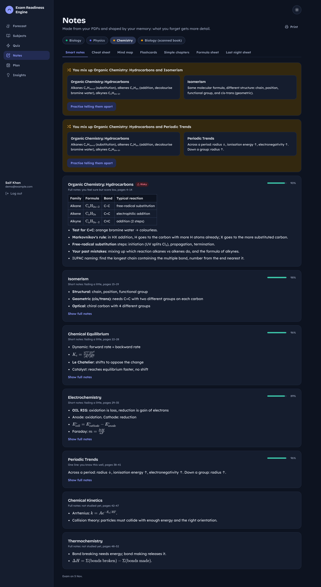
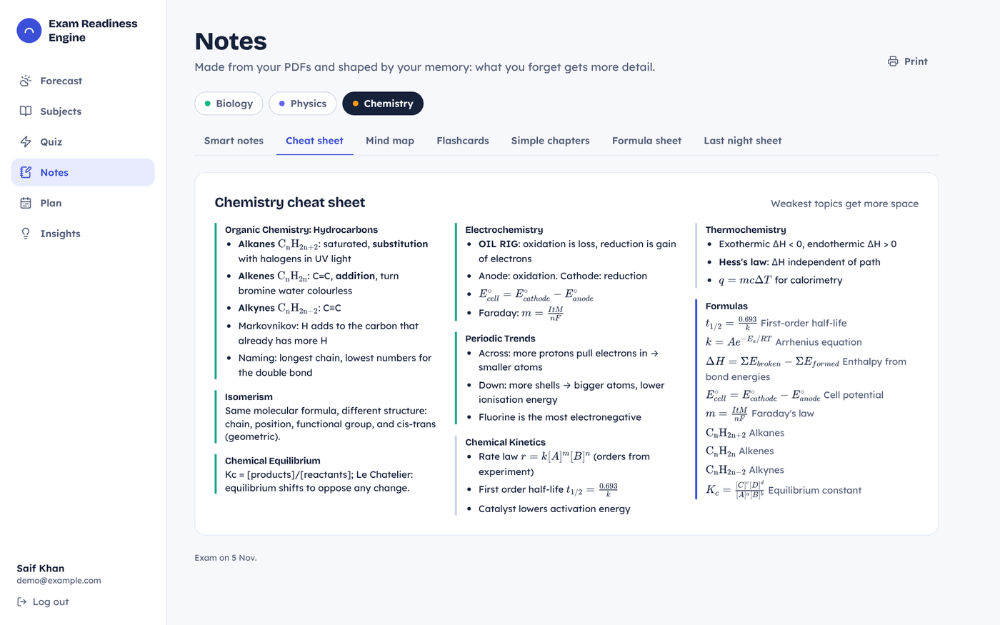
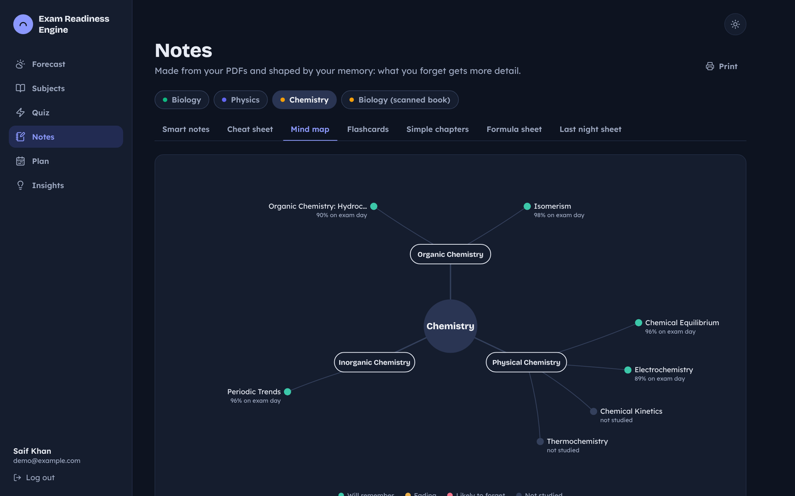
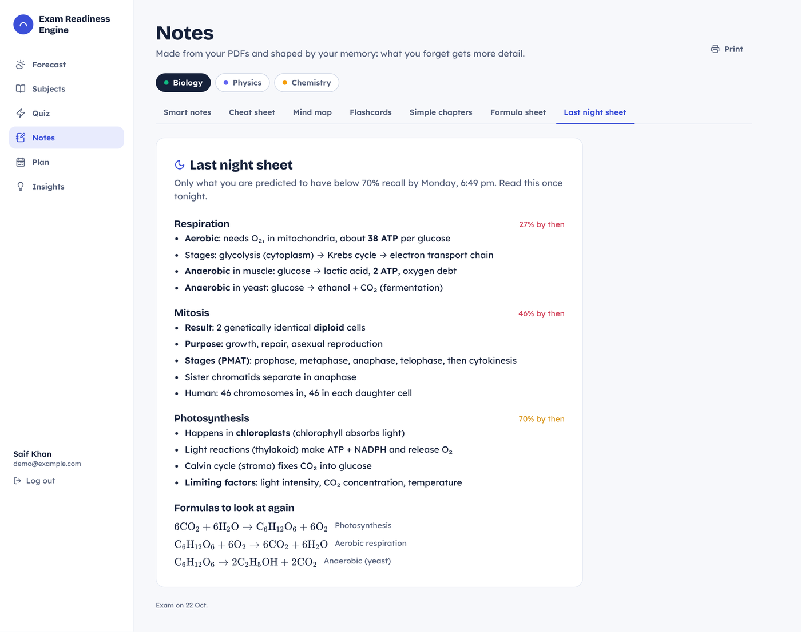
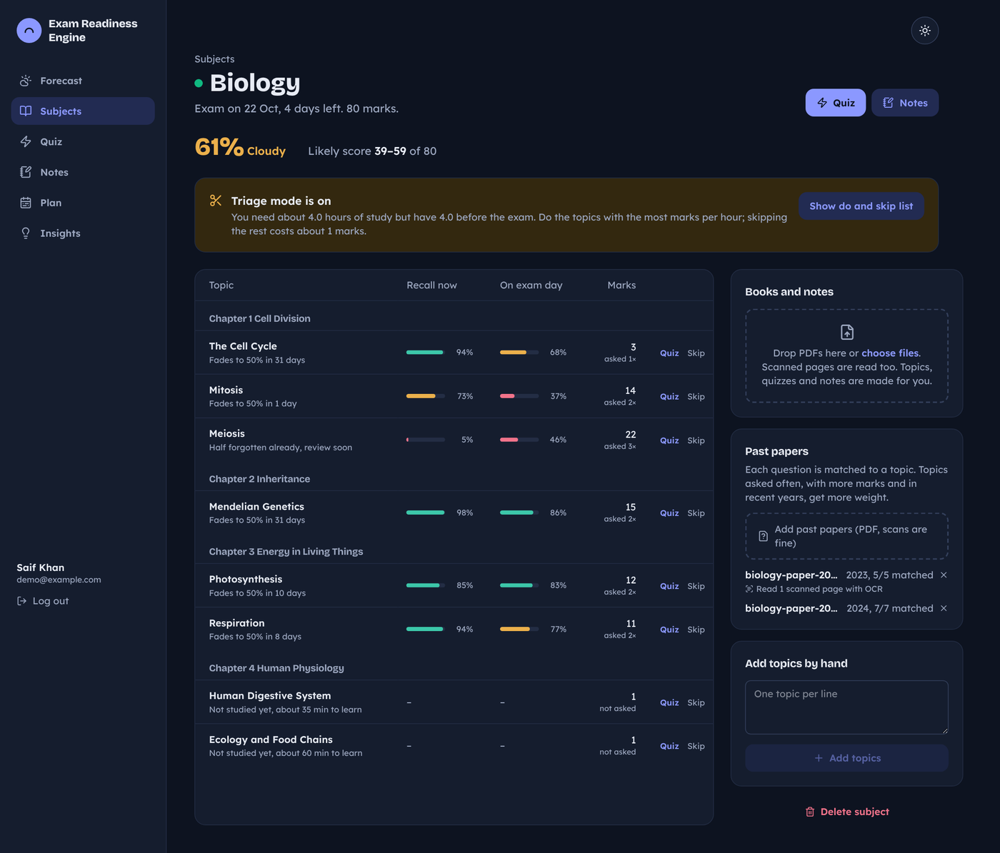
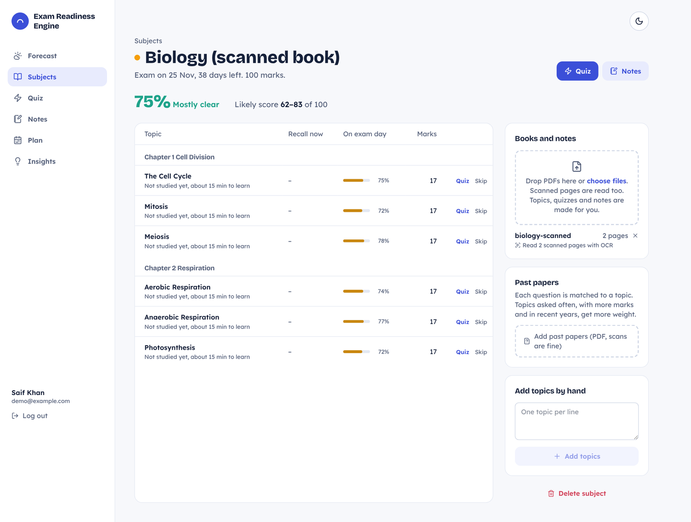
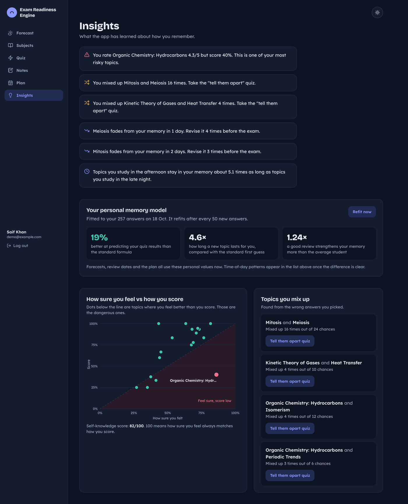
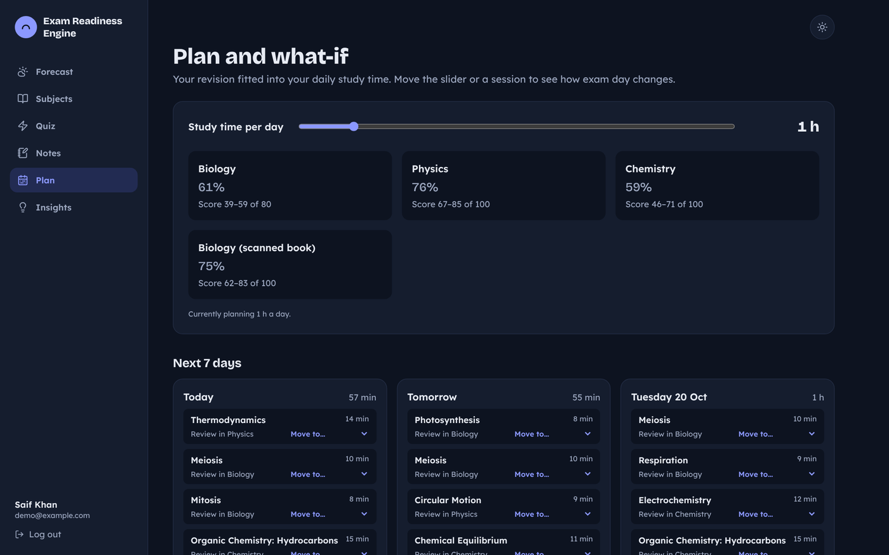
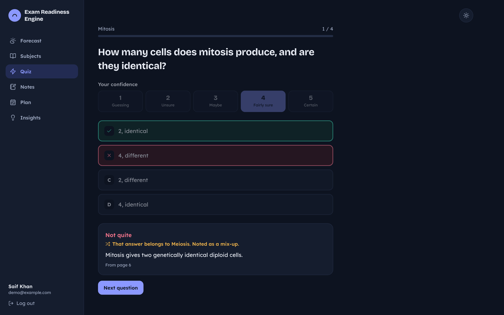
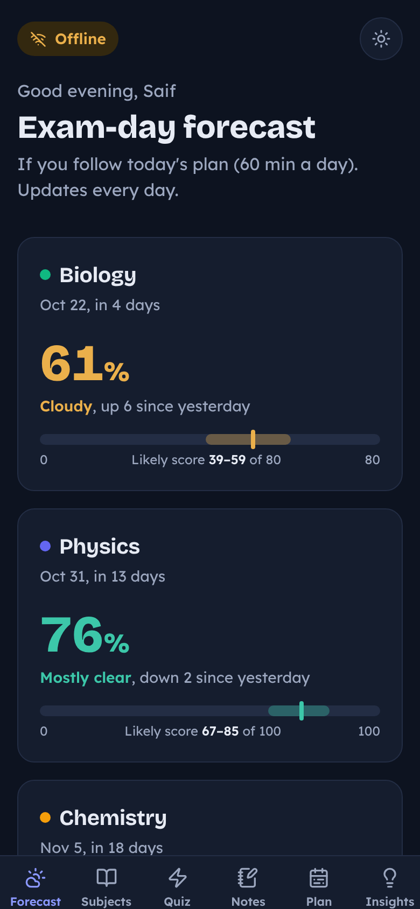

# Exam Readiness Engine

A study app that learns how fast **you** forget each topic, plans revision around your free time, and shows a daily exam-day forecast for every subject.

Full design and formulas: [spec.md](spec.md).

| Light | Dark |
|---|---|
|  |  |

## Features

- **Email code login**: sign up with name + email, log in with a 6-digit code, stay logged in for a year.
- **Subjects**: add several at once with the "+" button, each with an exam date, total marks, topics and PDFs.
- **PDF → topics, notes, formulas, quizzes**, in the background with a progress bar. Uses Claude when `ANTHROPIC_API_KEY` is set; otherwise an offline fallback picks key sentences, formulas and definition questions.
- **Scanned PDFs (OCR)**: pages without text are read with Tesseract. English data is bundled, so no internet is needed.
- **Past papers**: upload old papers; questions, marks and year are found and matched to topics. Topics asked more often, for more marks and more recently get more weight. Unmatched questions can be assigned by hand.
- **Quiz** with a confidence rating before every answer. Wrong options are tagged with the topic they belong to, so mix-ups are caught.
- **Personal forgetting curve** for every topic, updated after each quiz.
- **Personal memory model**: after 100 answers the model is fitted to your own history (refits every 50 answers), and Insights shows how much better it predicts you.
- **Exam-day forecast**: readiness %, likely score range and a 14-day trend.
- **Planner** fitting reviews into your daily study time, **triage mode** (marks per hour, do / skip list), and a **what-if** slider; you can also move sessions between days.
- **Insights**: risky topics (feel sure, score low), topics you mix up, how fast topics fade, and study-time patterns (only shown when the difference is statistically clear).
- **Notes** in 7 views: smart notes (detail follows your memory), cheat sheet, mind map, flashcards, simple chapters, formula sheet sorted by forget-risk, and a last night sheet.
- **Works offline on the phone**: install it to the home screen. Pages you have opened keep their data, and quizzes work offline and sync when you are back online.
- **Light and dark mode**: use the sun / moon icon at the top of any page.

## Screenshots

| | |
|---|---|
|  Smart notes |  Cheat sheet |
|  Mind map |  Last night sheet |
|  Past papers |  Scanned book read with OCR |
|  Insights and personal model |  Plan and what-if |
|  Quiz |  Offline on a phone |

The screenshots use the demo account (`npm run seed:demo`): three weeks of simulated study history replayed through the real engine. Its notes are sample content in the same shape the AI step produces.

## Run locally

Needs Node 22.

```bash
npm install
npm test                 # engine unit tests
npm run seed:demo        # optional: demo student (log in with demo@example.com)
npm run dev              # API on :3001, app on http://localhost:5173
```

With no email settings, the login code is printed in the server log and shown on screen.

To try offline mode, use the production build (the service worker is off in dev):

```bash
npm run build
OTP_DEMO_MODE=true JWT_SECRET=dev npm start   # http://localhost:3001
```

## Environment variables

Copy `.env.example` to `server/.env`.

| Variable | Purpose |
|---|---|
| `JWT_SECRET` | Required in production |
| `GMAIL_SCRIPT_URL`, `GMAIL_SCRIPT_SECRET` | Send codes through a Google Apps Script (works on Railway Hobby). Paste `gmail-sender.gs` into script.google.com, set the same secret, deploy as a Web app with access "Anyone". |
| `GMAIL_USER`, `GMAIL_APP_PASSWORD` | Or send through Gmail SMTP |
| `OTP_DEMO_MODE` | `true` shows the code on screen in production (demo only) |
| `ANTHROPIC_API_KEY` | Claude writes topics, notes and questions from PDFs and matches past-paper questions |
| `AI_MODEL` | Optional model override |
| `DATA_DIR` | Folder for the SQLite file and uploads (use a Railway volume) |
| `APP_NAME` | Name shown in emails |

## Deploy on Railway

1. Push this repo to GitHub and create a Railway service from it (the Dockerfile is used).
2. Add a volume mounted at `/data` (the Dockerfile sets `DATA_DIR=/data`).
3. Set `JWT_SECRET` and the email variables above.

## Layout

```
client/            React + Vite + Tailwind, PWA (offline), light/dark theme
server/            Express API, PDF + OCR jobs, past papers, personal model, AI, demo seed
packages/engine/   memory model, forecast, planner, triage, insights, model fitting (pure TypeScript, tested)
docs/screenshots/  images used in this README
```
