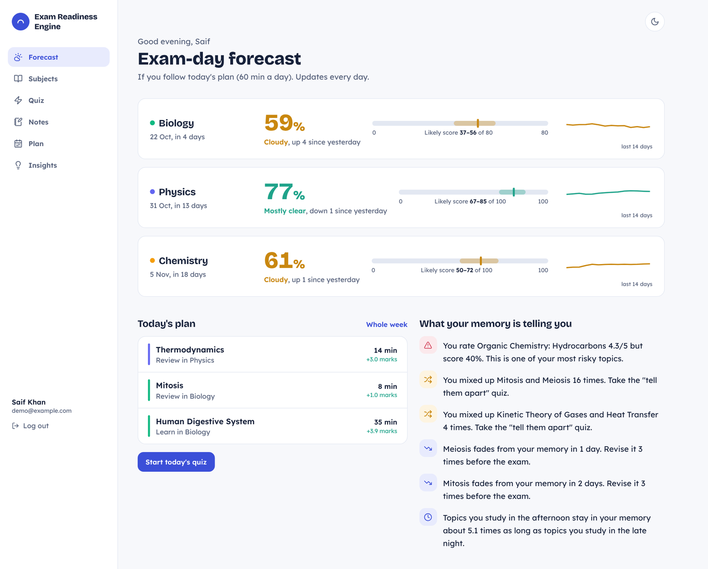
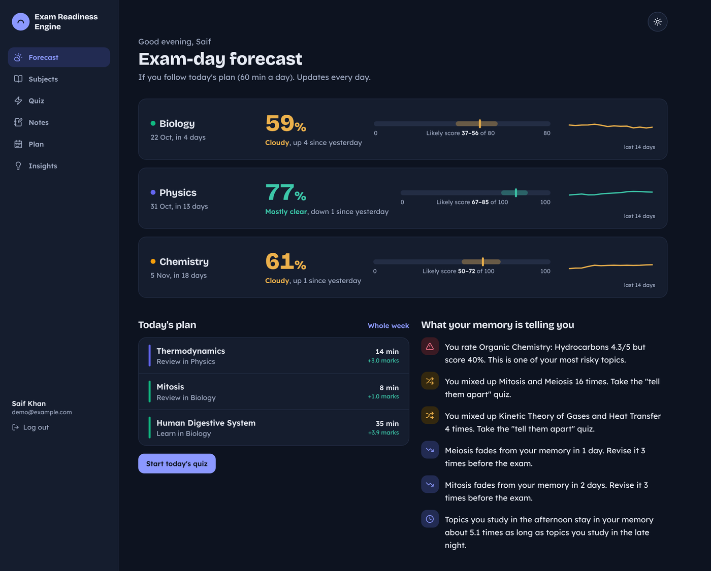

# Exam Readiness Engine

A study app that learns how fast **you** forget each topic, plans revision around your free time, and shows a daily exam-day forecast for every subject.

Full design and formulas: [spec.md](spec.md).

| Light | Dark |
|---|---|
|  |  |

## Features

- **Email code login**: sign up with name + email, log in with a 6-digit code, stay logged in for a year.
- **Subjects**: add several at once with the "+" button, each with an exam date, total marks, topics and PDFs.
- **PDF → topics, notes, formulas, quizzes**, in the background with a progress bar. Uses Claude when `ANTHROPIC_API_KEY` is set; otherwise an offline fallback picks key sentences, formulas and definition questions.
- **Scanned PDFs (OCR)**: pages without text are read with Tesseract. English data is bundled, so no internet is needed.
- **Past papers**: upload old papers; questions, marks and year are found and matched to topics. Topics asked more often, for more marks and more recently get more weight. Unmatched questions can be assigned by hand.
- **Quiz** with a confidence rating before every answer. Wrong options are tagged with the topic they belong to, so mix-ups are caught.
- **Personal forgetting curve** for every topic, updated after each quiz.
- **Personal memory model**: after 100 answers the model is fitted to your own history (refits every 50 answers), and Insights shows how much better it predicts you.
- **Exam-day forecast**: readiness %, likely score range and a 14-day trend.
- **Planner** fitting reviews into your daily study time, **triage mode** (marks per hour, do / skip list), and a **what-if** slider; you can also move sessions between days.
- **Insights**: risky topics (feel sure, score low), topics you mix up, how fast topics fade, and study-time patterns (only shown when the difference is statistically clear).
- **Notes** in 7 views: smart notes (detail follows your memory), cheat sheet, mind map, flashcards, simple chapters, formula sheet sorted by forget-risk, and a last night sheet.
- **Works offline on the phone**: install it to the home screen. Pages you have opened keep their data, and quizzes work offline and sync when you are back online.
- **Light and dark mode**: use the sun / moon icon at the top of any page.

